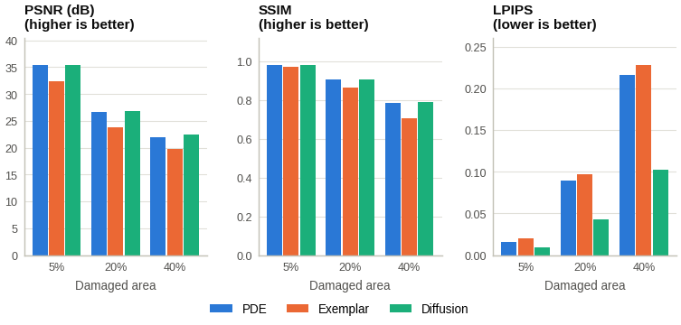
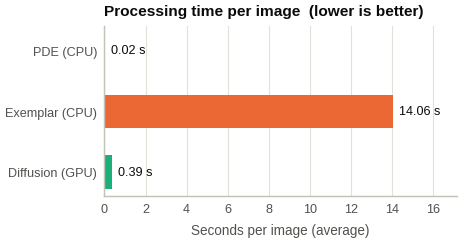
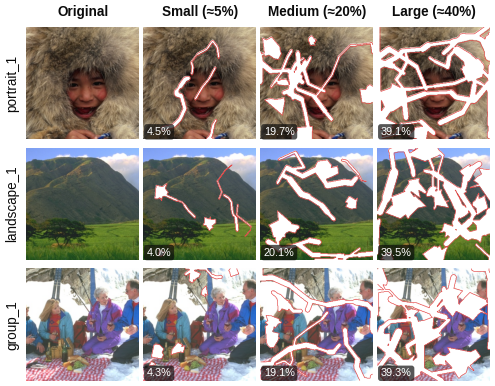
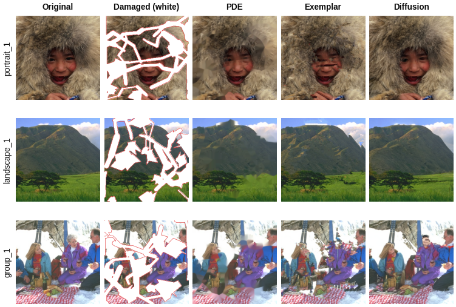
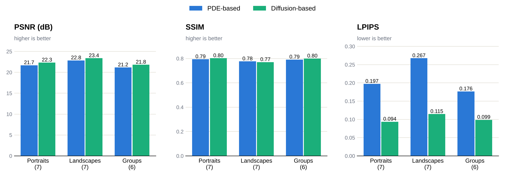

# Classical vs Diffusion-Based Image Inpainting for Photo Restoration — a Pilot Study

[](https://colab.research.google.com/github/YOUR_GITHUB_USERNAME/inpainting-pilot-study/blob/main/notebooks/inpainting_pilot_study.ipynb)

**Authors:** Dilyara Kurmangazykyzy, Saule Karimova  
**Group:** BDA-2405, Astana IT University  
**Supervisor:** Karashbaeva Zhanat  
**Course:** RMT (mini-diploma), 2026

This repository contains the code, results, figures, paper and poster of a pilot study that compares three image-inpainting methods on damaged photographs:

| Family | Method | Implementation |
|---|---|---|
| PDE-based (baseline) | Navier–Stokes | OpenCV `cv2.inpaint(..., INPAINT_NS)`, radius 3 px |
| Exemplar-based (baseline) | Criminisi et al. | Own Python implementation, 9 × 9 px patches |
| Diffusion-based | ResShift (Yue et al., TPAMI 2025) | Official pretrained inpainting model, 4 sampling steps |

**Research questions**

1. How do the three methods differ in restoration quality (PSNR, SSIM, LPIPS) at about 5 %, 20 % and 40 % damage?
2. How much processing time does each method need?
3. Does any method add details that were never in the original photograph?

---

## Key findings

> The diffusion-based method had the lowest LPIPS in **all 20 photographs at every damage level**, but at 40 % damage it **replaced a person's face** with a different one, which none of the scores detected.

| Damage | Method | PSNR (dB) ↑ | SSIM ↑ | LPIPS ↓ | Time (s) ↓ |
|---|---|---|---|---|---|
| Small (≈5 %) | PDE-based | 35.33 ± 3.36 | **0.9813** ± 0.0059 | 0.0157 ± 0.0081 | **0.005** |
| | Exemplar-based | 32.34 ± 3.75 | 0.9709 ± 0.0065 | 0.0206 ± 0.0073 | 3.260 |
| | Diffusion-based | **35.43** ± 3.21 | 0.9804 ± 0.0063 | **0.0095** ± 0.0044 | 0.388 |
| Medium (≈20 %) | PDE-based | 26.60 ± 2.84 | 0.9072 ± 0.0171 | 0.0891 ± 0.0244 | **0.020** |
| | Exemplar-based | 23.88 ± 3.06 | 0.8643 ± 0.0221 | 0.0973 ± 0.0245 | 13.318 |
| | Diffusion-based | **26.86** ± 2.43 | **0.9084** ± 0.0205 | **0.0430** ± 0.0108 | 0.384 |
| Large (≈40 %) | PDE-based | 21.94 ± 2.43 | 0.7867 ± 0.0472 | 0.2156 ± 0.0640 | **0.035** |
| | Exemplar-based | 19.70 ± 2.75 | 0.7070 ± 0.0418 | 0.2280 ± 0.0340 | 25.606 |
| | Diffusion-based | **22.54** ± 2.75 | **0.7900** ± 0.0521 | **0.1025** ± 0.0288 | 0.383 |

Mean ± SD over 20 photographs per row; best value per damage level in bold.

- The three methods differed on every quality measure at every damage level (Friedman χ² = 28.3–31.6, p < .001).
- The PDE-based and diffusion-based methods were almost tied on PSNR and SSIM. On LPIPS, the diffusion-based method was better in 20 of 20 photographs at every level (Holm-corrected Wilcoxon p < .001). Its PSNR lead was significant only at 40 % damage (+0.60 dB, p = .030).
- Against the exemplar-based method, the diffusion-based method was better on every measure in 20 of 20 photographs.
- The PDE-based method was the fastest. The diffusion-based method needed about 0.38 s regardless of damage, and only the exemplar-based method slowed down as damage grew (3.26 → 25.61 s). The order was the same in every photograph (Friedman χ² = 40.0).

### Figures

| | |
|---|---|
|  |  |
| Mean PSNR, SSIM and LPIPS per damage level | Mean processing time per image |


*Simulated damage at the three levels (white = damaged area).*


*Restorations at 40 % damage. In `group_1` the diffusion-based method replaces the white-haired woman in the centre with a different person.*


*PDE-based vs diffusion-based at 40 % damage, per photo type.*

---

## Repository structure

```
inpainting-pilot-study/
├── notebooks/
│   └── inpainting_pilot_study.ipynb   # the experiment as it was run (Colab), with all outputs saved
├── src/inpainting_study/              # the same code as Python modules
│   ├── config.py                      # settings: image size, damage levels, seed, the 20 BSDS500 photos
│   ├── data.py                        # download + checksum check + crop/resize of the photographs
│   ├── masks.py                       # irregular stroke/blotch damage masks (5 %, 20 %, 40 %)
│   ├── methods.py                     # PDE-based (OpenCV NS), exemplar-based (Criminisi), diffusion-based (ResShift)
│   ├── metrics.py                     # PSNR, SSIM, LPIPS, PSNR inside the hole
│   ├── analysis.py                    # summary tables, Friedman / Wilcoxon / Holm, diffusion vs baselines
│   └── plotting.py                    # all result figures
├── scripts/
│   ├── run_experiment.py              # runs the whole study from the command line
│   ├── verify_reproducibility.py      # checks that the code reproduces the published numbers (CPU, ~10 s)
│   └── make_report_figures.py         # rebuilds the paper / poster / README figures from the result tables
├── figures/                           # every figure produced by the notebook (PNG)
├── results/
│   ├── tables/                        # results as CSV (see below)
│   ├── key_results.md                 # auto-generated summary printed by the notebook
│   ├── mask_coverage_summary.txt      # actual share of damaged pixels per level
│   └── environment.txt                # software and hardware used for the run
├── paper/
│   ├── paper.pdf                      # final paper (IEEE conference format)
│   ├── main.tex, references.bib       # LaTeX source
│   └── figures/                       # figures used in the paper
├── poster/
│   ├── poster.pdf                     # A1 conference poster
│   └── poster.tex, references.bib, *.png
├── requirements.txt
├── CITATION.cff
├── LICENSE
└── README.md
```

### Result tables (`results/tables/`)

| File | Content |
|---|---|
| `table_main_mean_sd.csv` | Mean and SD of PSNR, SSIM, LPIPS and time for each method × damage level (Table I of the paper) |
| `diffusion_vs_baselines.csv` | Diffusion-based minus each baseline: mean difference, photos where diffusion was better, Holm-corrected p, effect size r (Table II) |
| `stats_friedman_wilcoxon_holm.csv` | Friedman test per measure and level, and all pairwise Wilcoxon tests with Holm correction |
| `summary_by_category.csv` | Mean PSNR, SSIM and LPIPS per photo type (portrait, landscape, group) and damage level (Table III) |
| `dataset_photos.csv` | The 20 BSDS500 photographs: study ID, BSDS ID, MD5 checksum and download URL |
| `per_image_example_group_1.csv` | Example of the per-image results for one photograph |

p-values shown as `0.0` are smaller than 0.0001 (rounded).

---

## How to reproduce

### Option 1: Google Colab (as in the study)

The notebook is self-contained and was run on **Google Colab with a T4 GPU** (about 15–20 minutes).

1. Open `notebooks/inpainting_pilot_study.ipynb` in Google Colab (button at the top of this page).
2. `Runtime → Change runtime type → T4 GPU`.
3. `Runtime → Run all`.

The notebook then:

- installs the packages and clones the official [ResShift](https://github.com/zsyOAOA/ResShift) repository;
- downloads the 20 test photographs from a pinned version of [BSDS500](https://github.com/BIDS/BSDS500) and verifies their MD5 checksums;
- generates the masks with fixed seeds (`SEED = 2026`), so every mask is identical on each run;
- runs the 180 restorations (20 photos × 3 damage levels × 3 methods) in a shuffled but fixed order;
- computes PSNR, SSIM and LPIPS (AlexNet) on the full 256 × 256 image, plus the statistical tests;
- saves all tables, figures, masks, damaged and restored images to `OUT_DIR` and downloads them as one zip.

### Option 2: command line (local machine with a CUDA GPU)

```bash
git clone https://github.com/YOUR_GITHUB_USERNAME/inpainting-pilot-study.git
cd inpainting-pilot-study
pip install -r requirements.txt
git clone https://github.com/zsyOAOA/ResShift.git          # official diffusion model code
python scripts/run_experiment.py --resshift-dir ResShift --out outputs
```

`scripts/run_experiment.py` runs exactly the same steps as the notebook, using the modules in `src/inpainting_study/`, and writes tables, figures, masks and all 180 restored images to `outputs/`.

Without a GPU, the classical methods can still be tested:

```bash
python scripts/run_experiment.py --classical-only --limit 3 --out outputs_test
```

### Check the reproducibility (no GPU needed)

```bash
python scripts/verify_reproducibility.py
```

This downloads the photographs, rebuilds all 60 masks and restores one photograph with the two classical methods. The mask coverage (4.60 %, 19.68 %, 39.69 %) and the PSNR and SSIM values match the original run exactly.

### Rebuild the report figures from the saved tables

```bash
python scripts/make_report_figures.py --out outputs/report_figures
```

### Environment of the reported run

Python 3.13, PyTorch 2.11 (CUDA 13.0), OpenCV 5.0, scikit-image 0.25, NumPy 2.1, GPU NVIDIA Tesla T4 (15.6 GB). See `results/environment.txt`.

---

## Method summary

- **Data:** 20 photographs from the BSDS500 test split (7 portraits, 7 landscapes, 6 group photos), centre-cropped to 321 × 321 px and resized to 256 × 256 px, the input size of ResShift.
- **Damage:** irregular masks of uneven strokes (scratches, tears) and jagged blotches (stains), generated until coverage is within ±1 percentage point of 5 %, 20 % or 40 %. Actual mean coverage: 4.6 %, 19.7 %, 39.7 %.
- **Design:** every method restores the same photos with the same masks at the same size, with default settings and a randomised run order.
- **Metrics:** PSNR, SSIM, LPIPS (AlexNet, v0.1) and processing time per image (model loading excluded).
- **Statistics:** Friedman test per measure and damage level, then Wilcoxon signed-rank tests with Holm correction (paired data, exploratory).
- **Visual check:** the first photograph of each type is inspected side by side for blur, misplaced patches and invented content.

## Limitations

- The damage is simulated, and the photographs are modern colour images reduced to 256 × 256 px rather than scanned old prints.
- Each family is represented by one method with default settings, and ResShift was run with one random seed, so the conclusions apply to these three methods.
- Scores are computed on the full image, which makes differences between methods look smaller than inside the damaged area.
- Invented details were judged visually by the authors on three photographs.
- Processing times depend on the implementations: OpenCV (optimised) versus plain Python for the exemplar-based method.
- Twenty photographs form a small sample, so the statistical tests are exploratory.

---

## Citation

If you use this code or these results, please cite:

```bibtex
@misc{kurmangazykyzy2026inpainting,
  author = {Kurmangazykyzy, Dilyara and Karimova, Saule},
  title  = {Comparison of Classical and Diffusion-Based Image Inpainting Methods for Photo Restoration: A Pilot Study},
  year   = {2026},
  note   = {Astana IT University},
  howpublished = {\url{https://github.com/YOUR_GITHUB_USERNAME/inpainting-pilot-study}}
}
```

## Third-party resources

- **BSDS500:** P. Arbeláez, M. Maire, C. Fowlkes and J. Malik, "Contour detection and hierarchical image segmentation," *IEEE TPAMI*, 2011. The photographs are not stored in this repository; the notebook downloads them from the official repository.
- **ResShift:** Z. Yue, J. Wang and C. C. Loy, "Efficient diffusion model for image restoration by residual shifting," *IEEE TPAMI*, 2025. The model code and weights are downloaded from the [official repository](https://github.com/zsyOAOA/ResShift) and are subject to its own license (NTU S-Lab License 1.0, non-commercial use).
- **LPIPS:** R. Zhang et al., "The unreasonable effectiveness of deep features as a perceptual metric," *CVPR*, 2018.
- **Criminisi algorithm:** A. Criminisi, P. Pérez and K. Toyama, "Region filling and object removal by exemplar-based image inpainting," *IEEE TIP*, 2004.

## License

The code in this repository is released under the [MIT License](LICENSE). The paper and poster are © 2026 the authors. Third-party datasets and models keep their own licenses.
